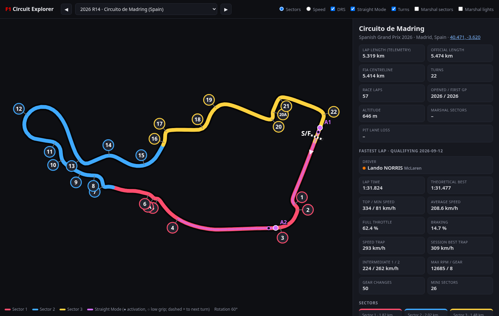

# f1data

Open data on Formula 1 circuits, plus a single-file viewer. It covers every circuit with its outline, timing sectors, turns, marshal sectors, DRS and 2026 Straight Mode zones, fastest-lap telemetry statistics and 2026 energy rules.



- **Dataset:** [`data/circuits.json`](data/circuits.json). The format is documented in [`docs/DATA_FORMAT.md`](docs/DATA_FORMAT.md).
- **Viewer:** [`app/index.html`](app/index.html). It is self-contained, opens from disk and needs no build step. Use the dropdown, the ◀ ▶ buttons or the arrow keys to switch tracks.

Current build: all 2025 circuits plus circuits new in 2026 (Madring, Sepang). Turn data, DRS zones and telemetry are taken from the most recent session with data. Straight Mode zones come from 2026 FIA documents.

## Usage

```bash
python3 -m venv .venv && .venv/bin/pip install -r requirements.txt
.venv/bin/python scripts/fetch.py 2025 2026   # download (cached in .cache/) -> data/circuits.json
.venv/bin/python scripts/render.py            # -> app/index.html
.venv/bin/python scripts/validate.py          # schema check (add --browser for a headless render test)
```

## Sources

| Source | Used for | Licence |
|---|---|---|
| [OpenF1](https://openf1.org) | Sessions, laps, sectors, telemetry, positions, results | MIT (API); F1 timing data |
| [MultiViewer API](https://api.multiviewer.app) | Corners, marshal sectors and lights, rotation, pit loss (the source FastF1 uses) | Public API |
| [bacinger/f1-circuits](https://github.com/bacinger/f1-circuits) | Circuit name, coordinates, length, opening year, altitude | MIT |
| [FIA documents](https://www.fia.com/documents/championships/fia-formula-one-world-championship-14) | Straight Mode zones, centreline, energy limits, regulations | Public documents (transcribed) |

Methods follow [FastF1](https://github.com/theOehrly/Fast-F1). The reference lap is the fastest timed lap of the session. Distance is computed by integrating speed. Sector boundaries come from sector times matched to position samples. The FIA publishes Straight Mode activation points only, so each zone's `end_m` is indicative (`end_basis: next_turn`). F1 does not publish active-aero telemetry. Not affiliated with Formula 1 or the FIA.

## Adding a new season or circuit

1. **Fetch:** run `scripts/fetch.py <seasons…>` in priority order. For example, `2026 2025` prefers 2026 sessions and falls back to 2025. Each circuit appears once, keyed by `circuit_id`. Events without data are listed under `skipped`.
2. **Turns:** these come from MultiViewer automatically. If a new circuit has no MultiViewer entry, add its official turn distances to `data/inputs/corner_overrides.json`. Without them, turns are estimated from curvature and flagged `auto_curvature`.
3. **FIA documents:** for each event, add one object to `data/inputs/fia_documents.json`. Copy the circuit-map URL, centreline length and Straight Mode activation points (as TurnRefs). Optionally add the Power Unit Information limits. Leave anything not published as `null`, and never estimate it.
4. **Regulations:** add article summaries for the new season to `data/inputs/regulations.json`.
5. **Rebuild:** run `render.py`, then `validate.py --browser`, and commit `data/` and `app/`.

New fields need four changes: bump `SCHEMA_VERSION` in `scripts/common.py`, update the spec in `scripts/validate.py`, update `docs/DATA_FORMAT.md` and update the viewer.
